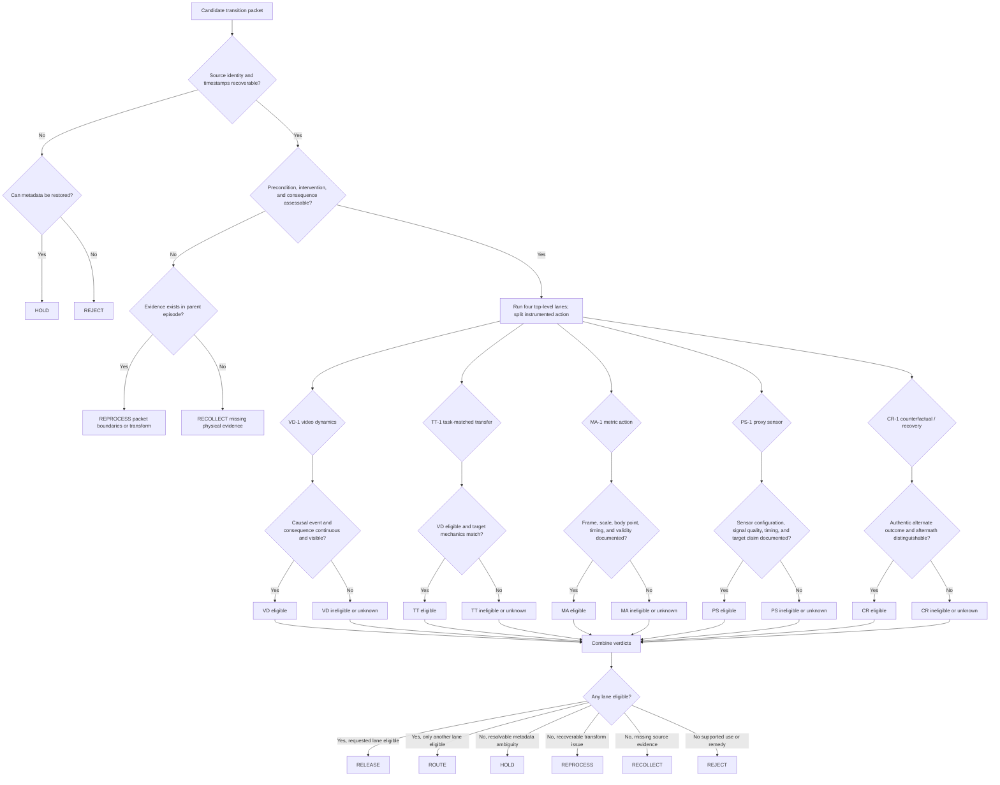

# Egocentric WAM Data Routing Decision Tree

**Policy version:** 0.2  
**Input:** One candidate transition packet  
**Output:** Four top-level lane decisions, instrumented-action subcontracts, one disposition, and reason codes

## Operating rule

Run common evidence checks once. Then run all four top-level lanes independently and split instrumented action into MA-1 and PS-1. Do not stop after the first rejection.

## Decision flow



## Step 1: Verify common evidence

Ask these questions before lane review:

1. Can the packet be mapped to an immutable source episode and exact source timestamps?
2. Are camera identity and processing version known?
3. Can a reviewer distinguish the starting state, attempted intervention, and observed consequence?
4. Are omitted ranges or discontinuities explicitly represented?
5. Is the event authentic, rather than a synthetic corruption or processing artifact presented as behavior?

If source evidence is intact but the packet boundaries or derived channels are wrong, choose `reprocess`. If the source never captured the required moment, choose `recollect`. Never use recollection to repair a transform that can be regenerated.

## Step 2: Evaluate VD-1 — video dynamics

```text
Is the relevant starting state observable?
├── no → ineligible: MISSING_PRECONDITION
├── unknown → unknown: PRECONDITION_AMBIGUOUS
└── yes
    Is the intervention and causal event temporally coherent?
    ├── no → ineligible: CAUSAL_EVENT_NOT_OBSERVED or TEMPORAL_DISCONTINUITY
    ├── unknown → unknown: CAUSAL_EVENT_AMBIGUOUS
    └── yes
        Is the physical consequence observable?
        ├── no → ineligible: MISSING_CONSEQUENCE
        ├── unknown → unknown: OUTCOME_UNRESOLVED
        └── yes → eligible
```

A task failure does not make VD-1 ineligible. A capture failure across the causal event usually does.

## Step 3: Evaluate TT-1 — task-matched transfer

Run only after evaluating VD-1.

```text
Is VD-1 eligible?
├── no → TT-1 ineligible or unknown for the same evidence deficiency
└── yes
    Does the intended state change match the declared target?
    ├── no → ineligible: TARGET_STATE_CHANGE_MISMATCH
    ├── unknown → unknown: TARGET_MATCH_UNRESOLVED
    └── yes
        Are the interaction mechanics and constraints compatible?
        ├── no → ineligible: TASK_MECHANICS_MISMATCH
        ├── unknown → unknown: MECHANICS_UNRESOLVED
        └── yes
            Is the viewpoint usable for the relevant transition?
            ├── no → ineligible: TARGET_INTERACTION_NOT_VISIBLE
            ├── unknown → unknown: VIEWPOINT_SUITABILITY_UNKNOWN
            └── yes → eligible
```

Language similarity is supporting metadata, not proof of mechanical compatibility.

## Step 4: Evaluate MA-1 — metric action

```text
Is the claimed body point or action variable defined?
├── no → ineligible: ACTION_SEMANTICS_UNDEFINED
└── yes
    Are coordinate frame, origin, scale, and units documented?
    ├── no → ineligible or unknown: COORDINATE_FRAME_UNKNOWN / UNITS_UNKNOWN
    └── yes
        Is synchronization with video verified?
        ├── no → ineligible or unknown: SENSOR_SYNC_UNVERIFIED
        └── yes
            Is the required motion valid through the interval?
            ├── no → ineligible: TRACKING_INVALID_DURING_EVENT
            ├── unknown → unknown: TRACKING_VALIDITY_UNKNOWN
            └── yes
                Is the human-to-target action mapping documented?
                ├── no → ineligible for retargeting: RETARGETING_MAPPING_UNDEFINED
                └── yes → eligible
```

An estimator returning coordinates is not, by itself, evidence that this contract is satisfied.

## Step 5: Evaluate PS-1 — proxy sensor

```text
Is the sensor type, placement, and configuration documented?
├── no → ineligible or unknown: PROXY_SENSOR_CONFIGURATION_UNKNOWN
└── yes
    Are signal/contact quality and missing-data semantics present?
    ├── no → unknown: PROXY_SENSOR_VALIDITY_UNKNOWN
    ├── degraded during the event → ineligible: SENSOR_CONTACT_DEGRADED
    └── yes
        Is synchronization with video verified?
        ├── no → ineligible or unknown: SENSOR_SYNC_UNVERIFIED
        └── yes
            Is the prediction or supervision target declared and validated?
            ├── no → ineligible: PROXY_TARGET_UNVALIDATED
            └── yes
                Is the signal presented as direct pose, contact, or force?
                ├── yes → ineligible: PROXY_SIGNAL_NOT_DIRECT_MEASUREMENT
                └── no → eligible
```

EMG-1 is the motivating case. It preserves aligned EMG when vision pose is unreliable, but does not claim that EMG directly measures pose, object contact, or force. [EMG-1 article](https://encord.com/data-labs/introducing-emg-1/)

## Step 6: Evaluate CR-1 — counterfactual and recovery

```text
Does the packet contain an authentic attempt or alternate strategy?
├── no → ineligible: NO_COUNTERFACTUAL_EVENT
├── unknown → unknown: EVENT_AUTHENTICITY_UNKNOWN
└── yes
    Can the attempted outcome be distinguished?
    ├── no → ineligible or unknown: OUTCOME_UNRESOLVED
    └── yes
        Is the subsequent response contiguous and observable?
        ├── yes → eligible
        ├── not applicable and outcome is complete → eligible
        ├── no because source ends → ineligible: RECOVERY_NOT_CAPTURED
        ├── no because derived crop ends → reprocess: RECOVERY_CROPPED
        └── unknown → unknown: RECOVERY_CONTINUITY_UNKNOWN
```

Synthetic corruptions may be useful for robustness testing, but they must occupy a separately declared synthetic-defect set—not CR-1 as authentic human behavior.

## Step 7: Choose the disposition

Apply the first matching rule:

1. **Release:** the originally requested lane is eligible.
2. **Route:** another lane is eligible even though the requested lane is not.
3. **Hold:** eligibility depends on metadata or adjudication that can reasonably be obtained.
4. **Reprocess:** the parent source contains the evidence, but a derived boundary, synchronization product, pose channel, or transform is defective.
5. **Recollect:** required physical evidence was not captured and the use remains important.
6. **Reject:** no lane is eligible and neither repair nor recollection is justified within scope.

## Decision output

```yaml
packet_id: source_17/episode_042/transition_006
eligibility:
  video_dynamics: eligible
  task_matched_transfer: eligible
  metric_action: ineligible
  proxy_sensor: ineligible
  counterfactual_recovery: eligible
decision:
  requested_lane: metric_action
  disposition: route
  route_to:
    - video_dynamics
    - task_matched_transfer
    - counterfactual_recovery
  reason_codes:
    - COMPLETE_FAILED_TRANSITION
    - RECOVERY_VISIBLE
    - COORDINATE_FRAME_UNKNOWN
    - PROXY_SENSOR_CHANNEL_ABSENT
  policy_version: "0.2"
```

The output records supported uses and preserves why the original request was denied. It does not compress the lane and subcontract verdicts into one quality score.
