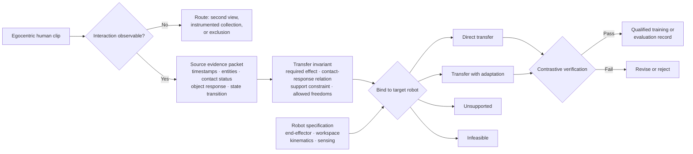

# The Label Between Egocentric Video and Robot Action

## An operational case study for cross-embodiment World Action Model data

**Status:** Proposed data workflow; not an empirical evaluation

**Scope:** Egocentric human and robot video for manipulation

## The problem

Egocentric video is becoming useful robot training data. DreamZero showed the clearest result for World Action Models (WAMs): adding 12 minutes of video-only human demonstrations for nine unseen tasks raised average task progress from 38.3% to 54.3%. The human clips supplied visual experience, not recovered robot actions. [DreamZero, §5.1 Q4](https://arxiv.org/abs/2602.15922)

That distinction matters. A human demonstration can show what task progress looks like without specifying how a different body should produce it.

Most familiar annotations describe the source video:

- where the hand and object are;
- when contact or a state change occurs;
- how the wrist and fingers move;
- which verb describes the activity;
- whether the final state appears successful.

These labels are valuable, but they do not answer the cross-embodiment question:

> **What physical relationship must survive when this interaction is performed by a different robot?**

A robot may need a different grasp, approach direction, supporting action, or arm path from the human demonstrator. Conversely, a generated robot video may look smooth and reach the correct final frame while showing contact that is physically wrong, causally unsupported, or impossible for the target embodiment.

This case study proposes a data operation for that gap: the **embodiment-invariant interaction contract**.

## Why this is a WAM data problem

Dream-1 shows that video can support meaningful zero-shot transfer across unseen robot embodiments. Its remaining limitations help locate the next frontier: determining which physical aspects of an interaction must remain invariant when the robot’s morphology or feasible motion changes. [Dream-1 research release](https://dreamlabs.ai/research/dream-1/)

Pixels create a bridge across embodiments, but they do not by themselves define which parts of an interaction are allowed to change.

Recent work is beginning to expose this missing layer. H2R-Bench evaluates human-to-robot video transfer using goal completion, action events, functional contact, object response, and embodiment correctness. Across the evaluated models, ordinary video quality had weak rank association with the transfer-aware score. In a matched ablation, replacing the complete demonstration with nine ordered frames preserved much of the final-state and broad action evidence, yet the transfer score fell by 27.6 points for a parallel-jaw gripper and 41.4 points for a dexterous hand; video quality barely changed. [H2R-Bench](https://arxiv.org/abs/2608.13049)

The implication is operational: final states and sparse keyframes are not enough. The dataset must preserve and describe the interaction that caused the state change.

## The operating workflow

### 1. Admit only interactions that can be grounded

A candidate clip must make the manipulated entity, task-relevant state change, and essential interaction assessable. The retained interval should include the approach, contact or causal event, object response, and stable consequence—not merely three keyframes.

When essential contact or object state is hidden, the reviewer records `not_observable`; the operation does not fill the gap with a confident label. A second view or synchronized sensor may resolve the case, but an inferred force or grasp should never be promoted into measurement.

This is narrower than generic video quality control. A blurry background may be irrelevant. A clean clip with an invisible contact event may be unusable for this contract.

### 2. Derive the invariant from source evidence

The source pass records the interaction interval, relevant entities, observable precondition and postcondition, contact status, and resulting object response. Every claim is marked `observed`, `inferred`, or `not_observable` and linked to supporting frames.

Only then does the reviewer derive the transfer invariant: the required effect, the contact–response relationship that produces it, any support constraint, and the execution variables allowed to change. Every requirement must point back to source evidence. If the video supports only an object response, the contract cannot claim the exact contact, intent, force, or hand configuration that caused it.

### 3. Bind the contract to a specified robot

The same source contract is reviewed against the target embodiment:

- end-effector type and usable contact surfaces;
- available single-arm or bimanual roles;
- reachable workspace and likely IK constraints;
- collision or arm-path concerns;
- whether an equivalent contact strategy exists;
- whether compliance, tactile sensing, or target-robot data is required.

The result is one of four decisions:

- **transferable:** the target can plausibly preserve the interaction directly;
- **transferable with adaptation:** the contact strategy changes while the function remains intact;
- **unsupported:** source evidence or robot metadata is insufficient;
- **infeasible:** the specified embodiment cannot realize the required interaction under the declared constraints.

This is an eligibility decision, not a guarantee that a trained policy will succeed.

### 4. Verify with contrastive cases

Ordinary success labels are weak tests of the contract. Quality control should include pairs that differ in one physically important way:

- correct final state versus correct causal interaction;
- correct contact region versus wrong manipulation mode;
- human-like motion versus robot-feasible motion;
- apparent contact versus contact hidden by occlusion;
- one valid strategy versus a different but equally valid embodiment-specific strategy;
- visually plausible motion versus an IK- or collision-infeasible future.

These contrasts make the record useful for evaluating generated futures, selecting human clips for a target robot, or auditing synthetic ego-to-robot data. They test whether the model preserved function rather than merely appearance.

## How this relates to existing work

The proposal does not claim that functional interaction annotation is untouched territory. It combines and operationalizes directions that are already emerging:

- **H2R-Bench** uses source-grounded goals, required events, functional contact regions and modes, object responses, support roles, and target-embodiment strategies; every annotation is manually verified. [Paper](https://arxiv.org/abs/2608.13049)
- **EgoLAP** replaces direct transfer of raw human trajectories with structured motion intent and reasoning grounded in contact, geometry, and object affordances. [Paper](https://arxiv.org/abs/2610.08726)
- **Ego2Robot** converts human demonstrations across 15 robot morphologies and filters IK failures, collisions, action discontinuities, and semantic inconsistency at several quality-control levels. [Paper](https://arxiv.org/abs/2608.02580)
- **Ego4WAM** finds that human–robot alignment, task diversity, duration, action supervision, and training stage have different downstream effects; aligned human data can reduce but not remove the need for robot supervision. [Paper](https://arxiv.org/abs/2609.40341)
- **ACE-Ego-0** treats human pseudo-actions as noisy auxiliary supervision and weights them by reliability rather than treating them as equivalent to sensor-recorded robot actions. [Paper](https://arxiv.org/abs/2606.17200)

Established datasets already cover many generic labels. Ego4D marks precondition, contact, point of no return, postcondition, hands, tools, objects, and state changes. HOT3D and EgoDex provide rich 3D hand and body trajectories. ContactPose provides detailed hand–object contact data. The proposed contribution is not to repeat these annotations; it is to turn available evidence into a decision about what is invariant, adaptable, unsupported, or infeasible for another embodiment. [Ego4D Hands and Objects](https://ego4d-data.org/docs/benchmarks/hands-and-objects/) [HOT3D](https://arxiv.org/abs/2411.19167) [EgoDex](https://arxiv.org/abs/2505.11709) [ContactPose](https://arxiv.org/abs/2007.09545)

## Boundaries

This workflow can support source curation, cross-embodiment evaluation, targeted human review, and the qualification of generated or retargeted training data. It does not establish that the resulting annotations improve policy success.

It also cannot recover information absent from the sensors. RGB video does not directly measure force, tactile state, friction, or grasp stability. A contract may identify when those variables matter and route a case toward instrumented collection, but it must not invent them.

Finally, embodiment invariance is conditional, not universal. A contact strategy transferable between two parallel grippers may fail for a suction cup or dexterous hand. Each transfer claim therefore names the target embodiment and retains the evidence used to make the decision.

## Conclusion

The frontier in egocentric WAM data is not another exhaustive action taxonomy. It is deciding what evidence can cross the embodiment boundary.

An interaction contract makes that decision explicit. It preserves the physical function demonstrated in video, allows robot-specific execution to change, exposes unsupported inference, and rejects futures that look correct without being physically grounded.

The resulting annotation answers a more useful question than “What did the human do?”

> **What must this robot preserve for the same interaction to remain valid?**
